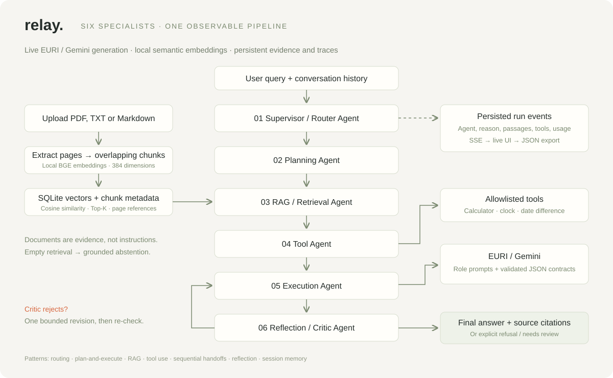
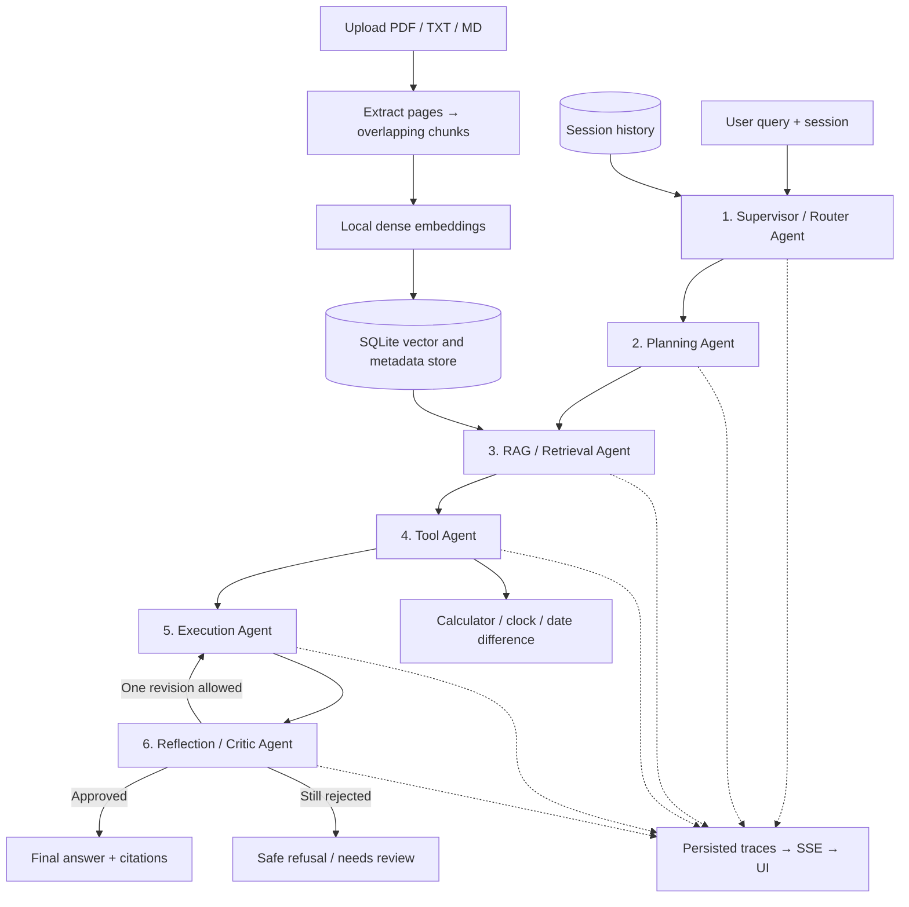

# Relay — Multi-Agent Agentic RAG Classroom

A working classroom application with six specialist agents, live Gemini generation through EURI, persistent document retrieval, safe tools, conversation memory, and an inspectable execution trace.

**No simulated answer mode.** Every model-driven decision and generated answer uses the configured EURI endpoint. Without a key, document ingestion still works; chat reports a configuration error. Test doubles exist only inside `tests/`.



## Visual code walkthrough

Use the [illustrated overview and three detailed teaching diagrams](docs/visuals/README.md)
for lectures or video recording. The detailed diagrams are **3840×2160 PNGs (16:9)**
with editable SVG sources. They explain which files/functions call each other,
document ingestion, and the query/critic sequence. The [file-by-file guide](docs/CODE_WALKTHROUGH.md)
also maps configuration, frontend, evaluation, and test files to their responsibilities.

### Interactive architecture explorer

[`docs/architecture_visualizer.html`](docs/architecture_visualizer.html) is a standalone,
dependency-free page; `scripts/sync_visualizer.py` copies it to `app/static/` so the running
app also serves it at **http://127.0.0.1:8000/architecture**. It has two modes and three panels.

*Explore the code* traces eight scenarios (multi-step, direct, document Q&A, tool, follow-up,
upload, missing evidence, critic revision) step by step over the runtime diagram at 0.5×/1×/2×.
*Live run / saved trace* drives the same diagram from real SSE events, an attached run ID, or an
imported trace export. The side panel holds the **Code** inspector (file, contract, callers,
callees, state change for every node), the **Client** simulator (the student-facing conversation;
typing a question in guided mode picks the code path that would handle it), and **Telemetry**
(EURI call count, prompt/completion tokens, stage `duration_ms`, retrieved passages and executed
tool calls, plus a colour-coded event stream and the full stage payloads).

The **Schemas + shared state** section shows all seven classes from `app/schemas.py`,
their fields and constraints, and where each contract is used. As you step through a
guided flow, it shows the fields each stage reads, its before/after writes, and the
accumulated state. Values in `<angle brackets>` are illustrative placeholders.
The critic-revision flow shows `feedback` capturing the rejected draft and critique
before `answer` and `critique` are replaced.

In **Live run / saved trace**, submit a question with **Run with EURI**, attach an
existing run using **Attach run**, or import a trace JSON file. Merely opening the
page does not automatically attach it to a run in the classroom tab. State changes
are reconstructed from request fields and recorded events; unexposed values such
as conversation history and the document inventory are not invented. Expand
**Inspect an earlier state transition** to review a previous write, then use
**Follow latest event** to resume watching. Upload documents in the classroom UI
first, and open `/architecture` through the running server for live requests.

Guided mode is honest about what it is: it makes no EURI request and never displays a generated
answer, and every telemetry counter stays blank until a real or imported run supplies it. Only
live and imported runs produce measured numbers.

Application modules, public classes/methods, API handlers, and Python utilities have
docstrings explaining their roles and important data/failure contracts. Ruff enforces
docstring presence and basic layout in shipped Python code; descriptively named tests
are exempt from docstring rules. Run `make lint` to check lint/docstrings and formatting,
or `make format` to apply Ruff formatting. CI runs both checks.

## Start locally

Use Python **3.12** (3.11–3.13 supported) and install [`uv`](https://docs.astral.sh/uv/getting-started/installation/) if it is not already available. From the project directory, install the dependencies and create the local environment file:

```bash
uv sync --locked
cp .env.example .env
```

Edit `.env` and set `EURI_API_KEY` to your EURI key. Keep the key private and do not commit `.env`. Chat requires this key; document ingestion can still be used without it.

Start the app with:

```bash
uv run uvicorn app.main:create_app --factory --host 127.0.0.1 --port 8000
```

Open **http://127.0.0.1:8000**. Interactive API documentation: **http://127.0.0.1:8000/docs**.

To warm the embedding model and check the EURI connection before starting the server, run:

```bash
uv run python scripts/preflight.py --warm-embeddings --check-provider
```

If `.env` already contains your settings, edit it instead of copying over it. As an alternative to `uv`, create and activate a Python 3.12 virtual environment, run `pip install .`, then start the server with `python -m uvicorn app.main:create_app --factory --host 127.0.0.1 --port 8000`.

The first embedding run downloads the actual `BAAI/bge-small-en-v1.5` model. Warm it before class. It produces 384-dimensional vectors on CPU, with no embedding API key. Local vectors, extracted text, sessions and traces live under `data/` and survive a restart. Model initialization may still check the model host; keep network available for the live EURI lesson.

## EURI / Gemini configuration

```dotenv
EURI_API_KEY=your_key_here
EURI_BASE_URL=https://api.euron.one/api/v1/euri
EURI_MODEL=gemini-3.5-flash-lite
```

The default endpoint/model are exactly the values requested for this project. Availability depends on your EURI account and gateway; it has **not** been confirmed without a working key. Click **Check connection** or use `scripts/preflight.py --check-provider` before teaching. If EURI rejects the model, set `EURI_MODEL` to a model enabled for your account and restart. The app never silently changes providers or models.

`app/llm.py` uses the asynchronous equivalent of the supplied OpenAI-compatible snippet:

```python
client = AsyncOpenAI(api_key=settings.euri_api_key.get_secret_value(),
                     base_url=settings.euri_base_url)
response = await client.chat.completions.create(
    model=settings.euri_model,
    messages=[{"role": "system", "content": system_prompt},
              {"role": "user", "content": payload}],
    temperature=0.1,
)
```

Each question normally uses 4 model calls (router, planner, execution, critic), or 5 with tool selection. A critic revision adds 2 calls. JSON format repair and provider retries can add calls. Responses are not token-streamed: the UI streams actual **agent events** as each stage starts and finishes.

If an agent returns invalid JSON, the app makes one repair request with the original
question context, the invalid response, and the validation errors. A second failure
identifies the contract and fields (for example, `Route` and `intent: literal_error`)
without exposing the model response in the error message. Retry the question; if
failures persist, verify that your configured EURI model supports schema-following
JSON responses. Restart the server after changing the Python code or `.env`.

## A live classroom walkthrough

1. Start the app and click **Check connection**. Show the returned provider model.
2. Upload `examples/course-handbook.md` and `examples/project-requirements.md`. These are editable teaching source documents, not precomputed answers. You can upload your own text PDFs, Markdown or UTF-8 text instead.
3. Click **Inspect chunks**. Explain page numbers, overlapping character offsets, vector creation and persistence.
4. Ask: “Explain retrieval-augmented generation in simple terms.” Observe retrieval/tool stages being explicitly skipped.
5. Ask: “According to the course handbook, what is the refund policy?” Inspect retrieved passages and `[S1]` citations.
6. Ask: “According to the course handbook, calculate the total course fee including GST for three students.” Inspect the plan, retrieved fee/GST, calculator arguments, result and critique. Expected total: INR 42,480.
7. Follow up: “What would that total be for two students?” Show that the router resolves the reference using conversation history and retrieval refreshes the evidence.
8. Ask: “Calculate 10 divided by 0.” The tool reports an error; the model must explain it.
9. Ask a missing document fact, such as campus parking charges. Show the absence of supporting evidence and an honest limitation.
10. Export the run JSON. Open `/docs` and show the same API independently of the UI.

See [the detailed teaching guide](docs/TEACHING_GUIDE.md) and [video outline](docs/VIDEO_SCRIPT.md).

## Architecture and agent patterns



| Agent | Decision / work | Implementation |
|---|---|---|
| Supervisor | Classifies intent, rewrites follow-ups, decides retrieval and tool use | `SupervisorAgent` |
| Planning | Produces steps, retrieval query and success criteria | `PlanningAgent` |
| Retrieval | Embeds the query, ranks by cosine similarity, applies Top-K and minimum score | `RetrievalAgent` |
| Tool | Chooses allowlisted tool calls through the LLM; validates and executes arguments | `ToolAgent` |
| Execution | Constructs context and generates a source-cited answer; abstains on empty retrieval | `ExecutionAgent` |
| Reflection | Reviews grounding, citations, tool results and completeness; can request one revision | `ReflectionAgent` |

These are six explicit agent classes with separate responsibilities, prompts/contracts and trace events. Retrieval is a deterministic specialist; it does not spend an LLM call to perform vector arithmetic. The agents share run state and communicate through an orchestrator. Patterns demonstrated: supervisor routing, sequential handoffs, plan-and-execute, model-directed tool use, retrieval augmentation, bounded reflection/revision, and conversational memory. The assignment's main sequence is preserved even when a stage is marked skipped.

## Complete RAG pipeline

| Requirement | Concrete implementation |
|---|---|
| Ingestion | Multipart upload; PDF page extraction or UTF-8 TXT/MD decoding |
| Chunking | Up to 900 characters, 150-character overlap by default, page-aware, whitespace boundary |
| Embeddings | Real local FastEmbed BGE model; normalized dense float32 vectors |
| Vector storage | Persistent SQLite BLOB vectors with metadata; NumPy exact cosine search |
| Retrieval / Top-K | Embed standalone planned query, descending similarity, configurable K=1–8 |
| Metadata | Document ID/name/hash, page, chunk position, character offsets, model, timestamp |
| Context | Bounded selected passages plus plan and actual tool outputs, serialized for the execution agent |
| Generation | Live EURI/Gemini call with grounding instructions |
| Citations | `[S1]` IDs mapped to actual retrieved chunks; deterministic invented-ID rejection plus LLM critique |

SQLite is the vector store here: normalized vectors persist alongside metadata, and NumPy performs an exact scan. It is intentionally straightforward to teach and suitable for small corpora, not an approximate-nearest-neighbor service. Uploads are capped at 100 documents, 10 MB each, 200 PDF pages and 1 million extracted characters per file. Scanned PDFs need OCR first. Files are not stored verbatim; extracted chunks and metadata are retained. Duplicate contents with the same embedding/chunk configuration are deduplicated.

`MIN_SIMILARITY=0.35` is a configurable heuristic, **not a confidence probability**. A high score does not prove a claim is supported. Context, citations and critic findings remain visible for inspection. Long multilingual text and complex tables may require a different embedding model/extractor. Changing the embedding model requires deleting and re-uploading older documents; the app will report a mismatch instead of comparing incompatible vectors.

## Tools and failure behavior

The calculator supports `+ - * / // % **` and parentheses using an AST allowlist. It never uses `eval`, shell commands, file access or arbitrary Python execution. Expression length, AST size, exponent and numeric magnitude are bounded. The clock uses IANA time zones, and date difference uses ISO calendar dates.

Provider errors (missing key, rejected key, unsupported model, timeout and quota), malformed agent JSON, missing documents, invalid uploads, empty retrieval, unsafe arithmetic and unresolved critiques have explicit failure paths. Structured output gets at most one format repair. A critic can request one revision; a second rejection returns a safe refusal and `needs_review` status, with the draft retained only in the inspectable trace.

## Tests and results

```bash
uv run pytest -q                         # deterministic component/integration checks
uv run ruff check app tests scripts      # static checks
uv run python scripts/evaluate.py        # 36 real application queries; server + EURI key required
```

`evaluation/queries.json` has **36 cases: 6 direct, 6 document, 6 tool, 6 multi-step, 6 follow-up and 6 failure cases**. The evaluator uploads the two teaching documents, creates independent sessions, preserves follow-up groups, and checks HTTP status, six-agent traces, selected tools, exact numeric results, expected answer patterns and valid citation IDs. It calls the actual running app; it never injects a fake provider. Allow time and sufficient EURI quota for well over 100 model requests.

The evaluator writes `reports/live-results.json` with full responses/traces and `reports/live-results.md` with the outcome table. It exits nonzero for failed or blocked runs. It records preflight failure honestly if credentials are missing. Pattern checks do not prove semantic correctness: manually review document entailment, completeness and failure quality before submitting. Use a clean classroom library for evaluation so unrelated documents do not affect retrieval.

Current verification evidence and limitations: [test results](docs/TEST_RESULTS.md). Unit/integration checks use explicit doubles or mocked HTTP inside `tests/`; those passes are **not** claimed as live Gemini results.

## API reference

| Method | Path | Purpose |
|---|---|---|
| GET | `/api/health` | Configuration and library status; never returns the key |
| POST | `/api/provider/check` | Real EURI connection check (consumes a small request) |
| POST / GET | `/api/documents` | Upload / list documents |
| GET | `/api/documents/{id}/chunks` | Inspect extracted chunks and page offsets |
| DELETE | `/api/documents/{id}` | Delete document and vectors; blocked during active runs |
| POST | `/api/sessions` | Create a conversation |
| GET | `/api/sessions/{id}/messages` | Read that conversation's history |
| POST | `/api/runs` | Start a query; returns HTTP 202 and run ID |
| GET | `/api/runs/{id}` | Read status, final result and trace |
| GET | `/api/runs/{id}/events` | SSE trace stream, with `Last-Event-ID` reconnection |

Example query body (create a session first):

```json
{"session_id":"<session ID>","query":"What is the course fee?","top_k":4,"document_ids":[]}
```

One active run per session prevents follow-up ordering races. Two runs execute concurrently; at most ten sessions can be queued. Run history is persisted, browser refresh reconnects to a saved active run, and interrupted runs are marked failed when the server restarts. Run with **one Uvicorn worker**; the in-process task queue and concurrency controls are not distributed.

## Docker

```bash
docker compose up --build
# Open http://localhost:8000
docker compose logs -f
docker compose down
```

The named volume preserves documents, model cache and traces. The API key is passed through `.env` at runtime and excluded from the image. The container runs as a non-root user. The Docker path is provided; see the test report for whether it has been exercised on this machine.

## Project map

```text
app/
  main.py           FastAPI endpoints, app factory, SSE
  agents.py         Six specialist agents and grounding checks
  orchestrator.py   Handoffs, bounded reflection, concurrency and traces
  llm.py            Live EURI adapter and structured response validation
  retrieval.py      Extraction, chunking, real embeddings and ingestion
  store.py          SQLite vectors, documents, sessions, runs and events
  tools.py          Safe calculator, clock and date difference
  config.py         Environment settings and validation
  schemas.py        Typed agent/API contracts
  static/           Browser UI (plain HTML, CSS and JavaScript)
evaluation/         36 categorized query cases
examples/           Editable teaching documents
scripts/            Preflight and live evaluation tools
tests/              Isolated automated checks; test doubles live here only
docs/               Diagram, teaching guide, video outline and results
```

## Teaching deployment boundaries

This is a **local, single-classroom application**. It has a shared document library and no authentication. Session IDs separate conversational context, not user permissions. Bind to localhost as shown. Before hosting it for untrusted users, add authentication, document/trace ownership checks, request-level upload limits, rate limiting and a durable external job queue. Do not expose this unmodified app publicly.

Uploaded passages and recent conversation messages needed for routing/generation are sent to EURI. Full evidence and model outputs are stored in local traces for teaching, so use documents appropriate to share with that provider and your students. Trace exports can contain uploaded text. API keys stay on the server and are excluded from the browser, traces and Git. Prompt-injection resistance is instructed and reviewed, but it is not a security guarantee.

## Submission checklist

- Publish this project directory as its own **public GitHub repository**, including README, diagram, code, `uv.lock`, cases and reviewed test results. Exclude `.env`, `.venv` and `data/`.
- Run all 36 live queries with your EURI account, inspect the results, and add a sanitized report to the repository (the raw live export is ignored by default).
- Record and upload the architecture explanation, code walkthrough and complete live demonstration to YouTube, using `docs/VIDEO_SCRIPT.md`.
- Add your actual repository URL and YouTube URL below. No external repository or video is claimed to exist yet.

Repository URL: **pending publication**  
YouTube URL: **pending recording and upload**

If this folder is inside another Git repository, initialize this folder as its own repository before staging files. Do not stage unrelated parent-folder changes. See [submission instructions](docs/SUBMISSION.md).

## Reference documentation

- [FastAPI file uploads](https://fastapi.tiangolo.com/tutorial/request-files/)
- [FastEmbed model initialization and embeddings](https://qdrant.tech/documentation/fastembed/fastembed-quickstart/)
- [FastEmbed supported models](https://qdrant.github.io/fastembed/examples/Supported_Models/)

The EURI configuration comes from the provided integration snippet; live account/model availability must be checked with your own key.
