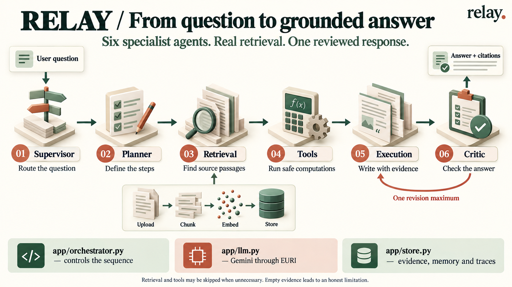
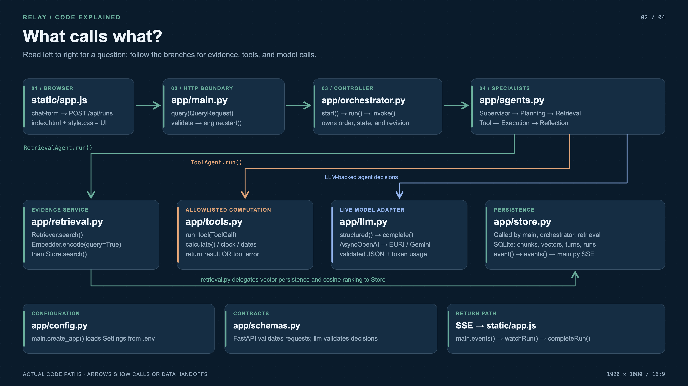
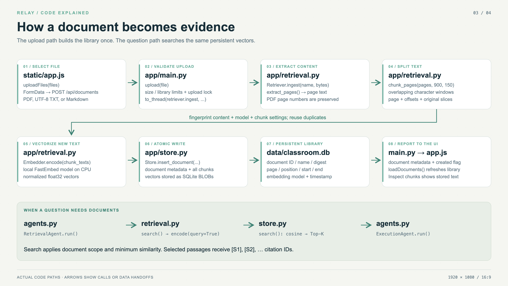
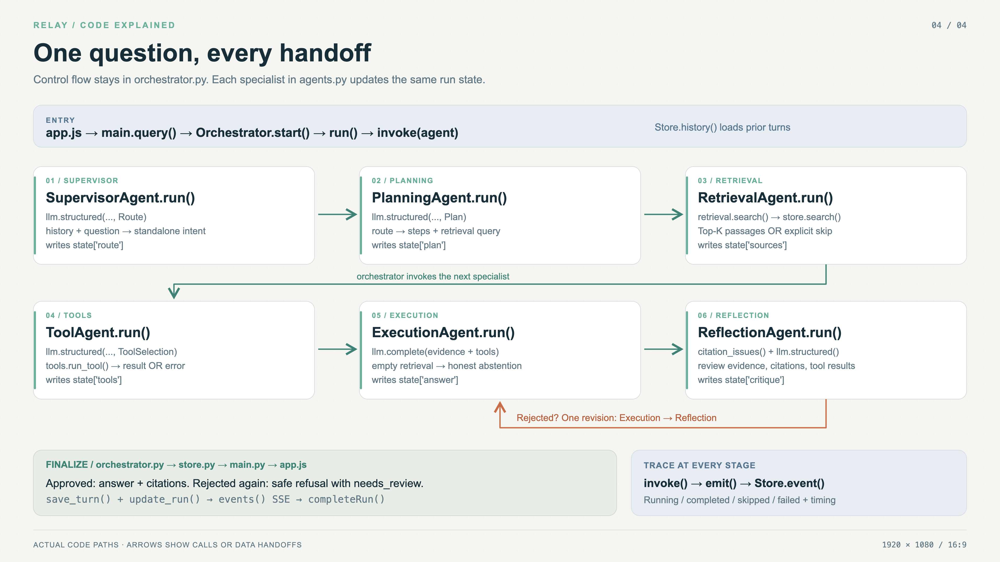

# Teaching image collection

Four complementary visuals explain the project at different levels. Start with the illustrated
overview, then use the precise diagrams while walking through the code.

| Image | Best use | Files |
|---|---|---|
| 01 — Illustrated overview | Explain the six agents and the evidence/revision concept | [PNG](01-illustrated-overview.png) |
| 02 — What calls what? | Show the runtime file dependencies and return path | [4K PNG](02-file-call-map.png) · [editable SVG](02-file-call-map.svg) |
| 03 — Document to evidence | Trace the upload, chunking, embedding, storage, and retrieval functions | [4K PNG](03-document-ingestion.png) · [editable SVG](03-document-ingestion.svg) |
| 04 — Question lifecycle | Follow state updates through six agents and the bounded critic loop | [4K PNG](04-question-lifecycle.png) · [editable SVG](04-question-lifecycle.svg) |

The three exact diagrams use a 1920×1080 vector artboard and export at **3840×2160**,
so they have a true 16:9 aspect ratio and stay sharp on lecture screens. The illustrated
overview is the built-in image generator's original **1672×941** output (approximately 16:9);
it has not been stretched or presented as a native 4K image.

## 01 — Illustrated overview



Generated with the **built-in image generation tool**, following the imagegen skill.
The exact final prompt is saved in [01-overview-prompt.md](01-overview-prompt.md).
This image is a conceptual teaching illustration; use the following diagrams for exact calls.

## 02 — Runtime file-call map



The top row is the main request path. Branches connect agent roles to their services.
`store.py` is shared by API, orchestrator, and retriever; it does not run as a seventh agent.
`config.py` and `schemas.py` support initialization/validation rather than becoming sequential pipeline stages.

## 03 — Document ingestion and retrieval



Steps 1–8 show a new document upload. Repeated content/configuration is deduplicated before
new embeddings are generated. The lower band shows how a later question retrieves the indexed evidence.
Arrows represent calls or returned data; database files never invoke Python functions themselves.

## 04 — Question lifecycle



Read the top row left to right, then the lower row left to right. The orange loop permits
one execution/critique revision. Empty-evidence abstention and its approval bypass those stages'
LLM calls; a skipped retrieval or tool stage still emits a trace event.

## Rebuild the precise diagrams

```bash
uv run python scripts/build_diagrams.py
# Optional image export tool; requires an installed Google Chrome browser.
npm install --no-save --package-lock=false playwright
node scripts/render_diagrams.mjs
```

The renderer can also accept an absolute path to an existing `playwright/index.mjs` installation.
It checks SVG text bounds before writing each PNG. Diagram rendering does not call EURI or modify
the document library. Keep the committed images for normal classroom use; no rendering dependencies
are required to open them.

For exact entry points, callers, callees, and support files, see [CODE_WALKTHROUGH.md](../CODE_WALKTHROUGH.md).
